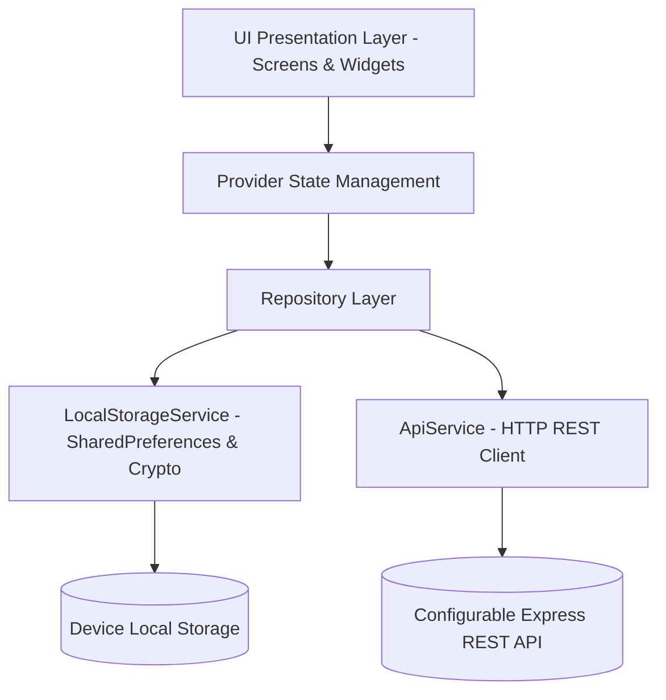

# CampusVerse — Premium College Event Management Application

[](https://flutter.dev)
[](https://dart.dev)
[](https://pub.dev/packages/provider)
[](https://flutter.dev)
[](https://m3.material.io)
[](backend/)

**CampusVerse** is a modern, cross-platform **College Event Management Application** built using **Flutter**, **Dart**, and **Material 3**. Engineered for academic mini-project demonstration and college project expos, it features a custom **Dark Glassmorphism UI** system, full **Provider** state management, separated Student and Organizer authentication workflows, authentic ISO **2D QR code tickets**, gate admission scanning with duplicate check-in prevention, and persistent local storage.

---

## Table of Contents

1. [Project Overview](#1-project-overview)
2. [Key Features](#2-key-features)
3. [Security Hardening & Authentication Architecture](#3-security-hardening--authentication-architecture)
4. [Collision-Proof Registration IDs & QR Ticket Verification](#4-collision-proof-registration-ids--qr-ticket-verification)
5. [Standalone Express Backend & Shared Verification](#5-standalone-express-backend--shared-verification)
6. [Data Persistence Audit (Local vs Remote)](#6-data-persistence-audit-local-vs-remote)
7. [Layout & Internal Scrolling Architecture](#7-layout--internal-scrolling-architecture)
8. [Developer Settings & REST API Integration](#8-developer-settings--rest-api-integration)
9. [Technology Stack & Packages](#9-technology-stack--packages)
10. [Design Direction & Glassmorphism System](#10-design-direction--glassmorphism-system)
11. [Application Architecture](#11-application-architecture)
12. [Folder Structure](#12-folder-structure)
13. [How to Run the Application & Backend](#13-how-to-run-the-application--backend)
14. [Running Flutter Analysis & Test Suite](#14-running-flutter-analysis--test-suite)
15. [Step-by-Step QA & Evaluation Workflows](#15-step-by-step-qa--evaluation-workflows)
16. [GitHub Pages Deployment](#16-github-pages-deployment)
17. [Mandatory Syllabus Mapping (Weeks 1 to 9)](#17-mandatory-syllabus-mapping-weeks-1-to-9)
18. [Academic Scope, Security & Deployment Disclosures](#18-academic-scope-security--deployment-disclosures)

---

## 1. Project Overview

Colleges host dozens of technical hackathons, coding workshops, cultural evenings, sports meets, and venture pitches every semester. Students frequently struggle with scattered Google Forms, lost confirmation emails, and cumbersome gate check-ins.

**CampusVerse** solves this by delivering a unified, polished mobile experience where:
- **Students** can discover campus events, inspect schedules and agendas, register seamlessly with duplicate prevention, view their personal digital passes, and access verified QR tickets.
- **Organizers** have a dedicated, protected administrative dashboard to create and edit campus events, inspect live attendee rosters, search attendees, and scan or manually verify tickets at admission gates with duplicate check-in prevention.

---

## 2. Key Features

- **Splash & Onboarding**: Animated brand entrance with glowing radial orb backdrop and automated session routing.
- **Dual-Role Authentication Portal**:
  - Separate tabs for **Student Access** and **Organizer Access**.
  - **Unlimited Student Account Creation** with full form validation, email normalization, and duplicate detection.
  - Returning student login by College Email or University Roll Number.
  - Quick 1-click sample student profiles for rapid evaluation.
  - Protected Organizer authentication with published demo credentials and 1-click evaluator login.
- **Discover & Explore Hub**:
  - Personalized student greeting with avatar and department badge.
  - Instant live keyword search bar.
  - Horizontal scrolling category filter chips with active gradient lighting.
  - Multi-parameter filtering (Upcoming, Past, All Timelines) and sorting (Date, Popularity, Capacity).
  - Responsive layout dynamically adapting across mobile, tablet, and web browsers.
- **Event Details & Validated Registration**:
  - Hero image animation smoothly transitioning between event cards and detail view.
  - Organizer identity pod, venue overview, agenda breakdown, and real-time seat availability.
  - Validated registration modal: ensures required fields, valid email, matching passwords, and terms acceptance.
  - Duplicate registration protection: prevents students from registering twice for the same event.
- **Digital Admission Pass (TicketCard)**:
  - Perforated circular side notches with a dashed tear-off line divider.
  - Real ISO-compliant **2D QR code matrix** generated via `qr_flutter`.
  - Unique verified Registration ID (e.g. `CV-2026-9481`).
  - Admission status badges (`CONFIRMED`, `CHECKED IN`, `CANCELLED`).
  - Registration cancellation with confirmation dialog.
- **My Events Center**:
  - Displays exclusively the active signed-in student's registrations and tickets.
  - Organized tabs: **Registered** (active upcoming passes), **Saved** (bookmarked favorites), and **Completed** (past events).
- **Organizer Dashboard & Management**:
  - Protected by role-aware guards (student accounts are denied administrative privileges).
  - Stat cards: Total Events, Upcoming, Signups, Checked In.
  - Event creation, editing, and deletion.
  - Live attendee registration roster with instant search and filter controls.
  - Direct attendance status toggles and link to Gate Scanner.
- **Organizer Ticket Scanner & Gate Entry**:
  - Live camera QR scanning with visual aim frame (`mobile_scanner`).
  - Dedicated **Manual / Demo Lookup** tab for testing without camera hardware.
  - Gate admission verification states: `VALID`, `ALREADY CHECKED IN`, `CANCELLED`, `EVENT MISMATCH`, and `UNRECOGNIZED`.
  - Duplicate check-in prevention: prevents a scanned ticket from being reused.
- **Dedicated Developer Settings**:
  - Separated from the student profile to maintain a professional user experience.
  - Offline Mock Mode vs Live REST API Mode switch.
  - Configurable remote endpoint base URL with validation.
  - Real HTTP diagnostic connection ping measuring round-trip network latency in milliseconds.

---

## 3. Security Hardening & Authentication Architecture

A rigorous security audit was conducted on the authentication and profile handling pipeline to eliminate credential vulnerabilities:

### 1. Plaintext Password Elimination
- **Model Decoupling**: The `password` field was completely removed from the `Student` Dart model, constructor, and `copyWith` method.
- **Serialization Protection**: Plaintext passwords are NEVER serialized into JSON or saved in `keyStudentProfile` or `keyStudentAccounts`.
- **Isolated Credential Store**: Passwords are saved in a private storage key (`campusverse_auth_credentials`) as salted **SHA-256** cryptographic hashes computed with unique roll number salts and application-level salt strings.
- **Session Decoupling**: Active sessions persist only the authenticated student's unique `rollNumber` (`campusverse_session_roll`). On cold start, the session is restored without re-verifying or exposing plaintext credentials.

### 2. Dual-Role Authentication & Access Control
- **Role Separation**: Students cannot perform organizer operations (creating events, viewing full attendee lists with other students' emails, gate scanning, check-ins).
- **Client-Side vs Backend Authorization**: Client-side role checking manages routing and UI states. When connected to the Express backend (`backend/`), authorization is strictly verified on every REST endpoint via Bearer tokens.
- **Evaluator Demo Access**: Preset demo accounts are clearly demarcated as academic demonstration accounts with explicit security warnings.

### Demo Credentials for Academic Evaluation

| Role | Email / Identifier | Password | Access Capabilities |
|---|---|---|---|
| **Admin (Organizer)** | `admin@gmail.com` | `admin` | Event creation, editing, attendee lists, QR gate scanning & check-in (Local Demo Mode) |
| **Sample Student 1** | `alex.chen@campusverse.edu` (Roll: `CS-2023-042`) | `Password@123` | Event browsing, registration, personal pass & QR ticket |
| **Sample Student 2** | `sophia.patel@campusverse.edu` (Roll: `EC-2024-019`) | `Password@123` | Event browsing, registration, personal pass & QR ticket |
| **Sample Student 3** | `david.m@campusverse.edu` (Roll: `IT-2022-088`) | `Password@123` | Event browsing, registration, personal pass & QR ticket |
| **New Student Accounts** | Any valid college email & roll number | Custom Password | Self-registration with email/roll duplicate detection |

---

## 4. Collision-Proof Registration IDs & QR Ticket Verification

### 1. Collision-Proof UUID Registration Identifier
Earlier revisions relied on a pseudo-random 4-digit numeric suffix (`CV-2026-XXXX`), which is mathematically susceptible to hash collisions under the Birthday Paradox after ~118 registrations.
- **New Architecture**: Every registration is assigned a guaranteed unique identifier using RFC 4122 UUID v4:
  ```text
  CV-2026-B8F4A1C2
  ```
- **Collision Loop Guarantee**: The repository checks `registrations.any((r) => r.registrationId == newId)` before issuing tickets.
- **Backward Migration**: Pre-existing 4-digit tickets are preserved and seamlessly resolved without data loss.

### 2. QR Ticket Creation & Privacy Protection
- Standard ISO/IEC 18004 QR payload:
  ```text
  CAMPUSVERSE:TICKET:CV-2026-B8F4A1C2
  ```
- **Student Privacy**: No passwords, personal contact numbers, or tokens are ever embedded inside QR payloads.
- Tickets are rendered with `qr_flutter` and can be reopened anytime from **My Events**.

### 3. Gate Scanner & Admission Verification
When organizers scan a pass (or use the **Manual / Demo Lookup** tab):
1. Payload is sanitized and parsed.
2. The registration is retrieved from local or remote stores.
3. System verifies admission rules:
   - `NOT FOUND`: Reject unrecognized ticket code.
   - `CANCELLED`: Reject tickets whose registration was cancelled.
   - `EVENT MISMATCH`: Reject tickets registered for a different campus event when a specific gate is locked.
   - `ALREADY CHECKED IN`: Reject duplicate admissions with admission timestamp.
   - `VALID`: Display student details and allow the organizer to confirm admission.

---

## 5. Standalone Express Backend & Shared Verification

GitHub Pages hosts the Flutter Web client statically, but cannot execute server-side code or host a shared database. To support real cross-device verification across separate phones/laptops, a standalone Express microservice is included in the repository under [`backend/`](backend/).

### Backend Architecture
- **Runtime**: Node.js & Express
- **Port**: `http://localhost:3000` (configurable via `process.env.PORT`)
- **Endpoints**:
  - `POST /api/auth/login`: Authenticates students and organizers; returns role-scoped tokens.
  - `POST /api/auth/register`: Creates student accounts with email/roll duplicate checks.
  - `GET /api/events`: Returns all collegiate events.
  - `POST /api/events`: Protected organizer route to create events.
  - `POST /api/registrations`: Registers a student and generates UUID tickets.
  - `POST /api/tickets/verify`: Verifies QR ticket validity.
  - `POST /api/tickets/check-in`: **Atomic check-in** preventing race conditions between multiple gate attendants.
  - `GET /api/health`: Diagnostic connection test endpoint.

### Verification Operating Modes

| Mode | Verification Source | Multi-Device Sync | Setup Required |
|---|---|:---:|---|
| **Mode A — Local Demo** *(Default)* | Client browser / device `SharedPreferences` | No (isolated to active browser) | None — Works instantly out-of-the-box on GitHub Pages |
| **Mode B — Live REST API** | Standalone Node.js Express Backend (`backend/`) | **Yes** (Shared database across all devices) | Run `cd backend && npm install && npm start` |

---

## 6. Data Persistence Audit (Local vs Remote)

| Data Category | Local Storage Key / Mechanism | Remote Authoritative Source (When Live API Enabled) | Malformed / Migration Handling |
|---|---|---|---|
| **Student Profiles** | `keyStudentAccounts`, `keyStudentProfile` | `GET /api/students/profile` | Safe JSON decoding with preset fallback |
| **Authentication & Credentials** | Salted SHA-256 in `keyAuthCredentials`, active session in `keySessionRollNumber` | `POST /api/auth/login` Bearer JWT | Plaintext passwords never persisted |
| **Campus Events** | `keyEventsList` | `GET /api/events`, `POST /api/events` | Falls back to default mock events if storage empty |
| **Registrations & Tickets** | `keyRegistrations` | `POST /api/registrations` | UUID collision check; legacy 4-digit ID migration |
| **Bookmarks / Saved Events** | `keyBookmarks` (List of Event IDs) | User profile bookmarks | Safe set filtering |
| **Notifications** | In-memory notification state | Notification push service | Cleared or seeded per session |
| **Theme Preferences** | `keyThemeMode` (`dark` / `light`) | Client preference | Defaults to Dark Glassmorphism |
| **Ticket Check-In Status** | `keyRegistrations` (`isCheckedIn`, `checkedInAt`) | `POST /api/tickets/check-in` (atomic) | Rejects duplicate gate check-in attempts |

---

## 7. Layout & Internal Scrolling Architecture

To prevent internal scrollbar conflicts, clipping, and RenderFlex overflow errors:
- **Natural Primary Scrolling**: All form screens, dashboards, and detail views use a single parent `SingleChildScrollView` or top-level `ListView`.
- **Keyboard Resilience**: Forms wrap their scroll areas with `SafeArea` and natural padding so fields remain fully visible and scrollable when the virtual keyboard appears.
- **Bottom Navigation Clearance**: The main application shell ensures page content does not clip behind the floating glass bottom navigation bar.
- **Cross-Device Adaptability**: Layouts scale smoothly on compact phones, large tablets, and desktop browsers without hardcoded fixed heights.

---

## 8. Developer Settings & REST API Integration

To preserve a clean, professional profile for normal students, developer tools are housed in a dedicated **Developer Settings** screen (accessible via a subtle shortcut in the student profile or the `/developer-settings` route).

### Features
- **Offline Mock vs Live REST API Switch**:
  - **Mock Mode**: Zero-latency responses using realistic collegiate events.
  - **Live Mode**: Actively communicates with remote microservices via HTTP.
- **Remote API Base URL Configuration**:
  - Validates `http://` and `https://` schemas and host format before saving.
  - Fallback and "Reset to Default URL" options.
- **Live HTTP Diagnostic Connection Test**:
  - Pings the remote endpoint (`/health` or `/events`) with a 5-second timeout.
  - Validates HTTP 200 responses.
  - Displays round-trip latency in milliseconds (`ms`).
  - Gracefully surfaces connection errors without crashing.

---

## 9. Technology Stack & Packages

- **Framework**: Flutter SDK (v3.27+)
- **Language**: Dart (v3.6+)
- **Design System**: Material 3 with Custom Dark Glassmorphism
- **State Management**: `provider: ^6.1.5`
- **Unique Identifier**: `uuid: ^4.5.1` (RFC 4122 v4 collision-proof registration IDs)
- **Security & Cryptography**: `crypto: ^3.0.6` (Salted SHA-256 password hashing)
- **QR Code Generation**: `qr_flutter: ^4.1.0`
- **Barcode & QR Scanning**: `mobile_scanner: ^7.4.2`
- **HTTP Networking**: `http: ^1.6.0`
- **Local Persistence**: `shared_preferences: ^2.5.3`
- **Date Formatting**: `intl: ^0.20.2`
- **Testing**: `flutter_test` (Unit, Widget, and Integration tests)
- **Backend**: Node.js & Express REST microservice ([`backend/`](backend/))

---

## 10. Design Direction & Glassmorphism System

CampusVerse implements a glassmorphism design system using Flutter's `BackdropFilter` and `ImageFilter.blur`:

```text
┌────────────────────────────────────────────────────────┐
│  Dark Background: #090D1A  (Deep Midnight Navy)        │
│  Surface Card:    #1E293B  (Slate 800 with 15% alpha)  │
│  Glass Borders:   #FFFFFF  (White with 12-17% alpha)   │
│  Primary Accent:  #6366F1  (Indigo 500)                │
│  Secondary Accent:#8B5CF6  (Violet 500)                │
│  Electric Accent: #38BDF8  (Sky 400)                   │
│  Blur Radius:     16.0 px (sigmaX: 16, sigmaY: 16)     │
│  Card Radius:     18.0 - 24.0 px                       │
└────────────────────────────────────────────────────────┘
```

Reusable visual components:
- `GlassCard`: Reusable glassmorphic surface with translucent color, background blur, and hairline borders.
- `GradientOrb`: Ambient radial gradient lighting creating depth behind cards.
- `CategoryChip`: Animated pill with vibrant gradient selection states.
- `CustomBottomNavigation`: Floating glass pill navigation bar with active glow.
- `TicketCard`: Realistic event pass with circular cutouts, dashed tear line, and verified QR code.

---

## 11. Application Architecture

CampusVerse adheres to clean architectural separation:



- **Models**: Immutable Dart data classes (`Event`, `Student`, `Registration`, `AppNotification`).
- **Services**: Low-level drivers (`ApiService` for HTTP requests, `LocalStorageService` for `SharedPreferences` & salted hash cryptography).
- **Repositories**: Business logic abstractions (`EventRepository`, `RegistrationRepository`).
- **Providers**: `ChangeNotifier` state containers (`ProfileProvider`, `EventProvider`, `RegistrationProvider`, `BookmarkProvider`, `NotificationProvider`, `ThemeProvider`).
- **Screens & Widgets**: Reactive presentation layer.

---

## 12. Folder Structure

```text
├── backend/                                   # Standalone Node.js Express REST API
│   ├── package.json                           # Express & CORS dependencies
│   ├── server.js                              # REST endpoints (auth, events, atomic check-in)
│   └── README.md                              # Backend setup & API reference
├── lib/
│   ├── main.dart                              # Main bootstrap, MultiProvider registration
│   ├── app.dart                               # MaterialApp routing & theme bindings
│   ├── core/
│   │   ├── constants/
│   │   │   ├── app_colors.dart                # Hex palettes, gradients, dark/light themes
│   │   │   └── app_constants.dart             # Categories, departments, demo credentials
│   │   ├── theme/
│   │   │   └── app_theme.dart                 # Material 3 ThemeData (dark & light)
│   │   └── utils/
│   │       ├── date_formatter.dart            # Date & time string formatting
│   │       └── responsive.dart                # Screen size breakpoints
│   ├── models/
│   │   ├── event.dart                         # Event model with JSON serialization
│   │   ├── student.dart                       # Student profile (strictly password-free)
│   │   ├── registration.dart                  # Registration model, check-in status, QR data
│   │   └── notification.dart                  # In-app notifications
│   ├── services/
│   │   ├── api_service.dart                   # HTTP client for REST backend
│   │   └── local_storage_service.dart         # Salted SHA-256 vault & SharedPreferences
│   ├── repositories/
│   │   ├── event_repository.dart              # Event coordination (Mock vs Live)
│   │   └── registration_repository.dart       # UUID ticket generation, QR parsing, check-in
│   ├── providers/
│   │   ├── profile_provider.dart              # Student registration, auth & organizer login
│   │   ├── event_provider.dart                # Search, category filters, CRUD operations
│   │   ├── registration_provider.dart         # Registrations, ticket verification, check-in
│   │   ├── bookmark_provider.dart             # Saved events state
│   │   ├── notification_provider.dart         # Notification state
│   │   └── theme_provider.dart                # Dark/light theme state
│   ├── screens/
│   │   ├── auth/
│   │   │   └── demo_login_screen.dart         # Dual-role Student / Organizer portal
│   │   ├── home/
│   │   │   └── home_screen.dart               # Discover hub, categories, mode pill
│   │   ├── explore/
│   │   │   └── explore_screen.dart            # Filterable event grid
│   │   ├── event_details/
│   │   │   └── event_details_screen.dart      # Event agenda, speakers, registration action
│   │   ├── registration/
│   │   │   └── event_registration_screen.dart # Validated registration form modal
│   │   ├── my_events/
│   │   │   └── my_events_screen.dart          # Active student's tickets and bookmarks
│   │   ├── organizer/
│   │   │   ├── organizer_dashboard_screen.dart# Role-protected administrative dashboard
│   │   │   └── ticket_scanner_screen.dart     # QR camera scanner & manual verification
│   │   ├── settings/
│   │   │   └── developer_settings_screen.dart # Dedicated REST API config & ping
│   │   └── profile/
│   │       └── profile_screen.dart            # Student profile, theme toggle, logout
│   └── widgets/
│       ├── glass_card.dart                    # Reusable glassmorphic surface
│       ├── ticket_card.dart                   # Perforated admission ticket pass
│       └── qr_matrix_painter.dart             # High-contrast 2D QR code renderer
```

---

## 13. How to Run the Application & Backend

### Prerequisites
- Flutter SDK (v3.27+) installed and accessible in `PATH`.
- Node.js (v18+) for running the optional Express backend.
- Google Chrome browser (for Flutter Web) or an Android/iOS emulator/device.

### 1. Running the Flutter Web Application
```bash
flutter pub get
flutter run -d chrome
```

### 2. Running on an Android / iOS Device
```bash
flutter run
```

### 3. Running the Standalone Express Backend (For Multi-Device Verification)
```bash
cd backend
npm install
npm start
```
The server starts on `http://localhost:3000`. In the Flutter app, open **Developer Settings** (via profile), enter `http://localhost:3000` (or your local IP `http://192.168.x.x:3000`), enable **Live REST API Mode**, and tap **Test Connection**.

---

## 14. Running Flutter Analysis & Test Suite

### 1. Static Code Analysis
Run the Flutter analyzer to confirm code health:
```bash
flutter analyze
```
*Result: **No issues found!***

### 2. Automated Test Suite
Execute the test suite covering authentication hardening, UUID collision resistance, duplicate prevention, ticket verification, gate admission, and role guards:
```bash
flutter test
```
*Result: **All 44 tests passed! (0 failures)***

### Test Suite Breakdown

| Test Suite | File | Tests | Focus Areas |
|---|---|:---:|---|
| **Authentication & Profile** | `test/unit/auth_provider_test.dart` | 10 | Student registration, duplicate email/roll checks, login, password-free serialization, salted SHA-256 |
| **Ticket & Gate Verification** | `test/unit/ticket_verification_test.dart` | 9 | UUID generation, 100-batch collision loop check, QR parsing, gate admission, event matching, duplicate check-in |
| **Registrations & Duplicates** | `test/unit/registration_test.dart` | 3 | Event registration, duplicate prevention, registration cancellation |
| **Event Filtering & Search** | `test/unit/event_filtering_test.dart` | 5 | Category filters, keyword search, popularity sorting, filter reset |
| **Event Model Serialization** | `test/unit/event_model_test.dart` | 3 | JSON parsing, serialization, capacity calculations |
| **Bookmark State** | `test/unit/bookmark_provider_test.dart` | 2 | Bookmark toggling, persistent storage |
| **Theme State** | `test/unit/theme_provider_test.dart` | 3 | Dark glassmorphism default, theme toggle, persistence |
| **Organizer Role Guard (UI)** | `test/widget/organizer_role_guard_test.dart` | 3 | Student access denial screen, organizer dashboard rendering, manual scanner lookup |
| **Home Screen (UI)** | `test/widget/home_screen_test.dart` | 3 | Personalized greeting, search bar, category chips, mode badge |
| **Registration Form (UI)** | `test/widget/registration_form_test.dart` | 2 | Field validation, terms acceptance checkbox |
| **Ticket Card (UI)** | `test/widget/ticket_card_test.dart` | 1 | Digital pass layout, QR code presentation |
| **App Shell (Integration)** | `test/widget_test.dart` | 1 | Full application boot and navigation |

---

## 15. Step-by-Step QA & Evaluation Workflows

Follow these workflows to evaluate all implemented features:

### Workflow 1: Unlimited Student Registration & Login
1. Launch the application.
2. If already logged in, navigate to **Profile** (bottom navigation tab 4) and tap **"Log Out Student Account"**.
3. On the Login screen (Student tab), tap **"Create New Student Account"**.
4. Fill in:
   - Full Name: `Maya Lin`
   - College Email: `maya.lin@campusverse.edu`
   - University Roll Number: `CS-2026-88`
   - Department: `Computer Science & Engineering`
   - Year: `2nd Year (Sophomore)`
   - Phone: `+1 555-0188`
   - Password: `Password@123`
   - Confirm Password: `Password@123`
5. Tap **"Create Account & Sign In"**.
6. Verify that Maya Lin is registered and redirected to the Home screen with her name in the top greeting.
7. Return to Profile, tap **"Log Out Student Account"**, and log back in using `maya.lin@campusverse.edu` (or `CS-2026-88`) and `Password@123`.

### Workflow 2: Event Registration & Unique QR Ticket Generation
1. In the Home or Explore tab, select an event (e.g. **"HackCampus 2026"**).
2. Tap **"Register for Event"**.
3. Review pre-filled student details, check the Code of Conduct terms, and tap **"Confirm Registration"**.
4. Observe the confirmed registration pass with its unique **Collision-Proof Registration ID** (`CV-2026-XXXXXXXX`) and authentic **2D QR code**.
5. Navigate to **My Events** (bottom navigation tab 3).
6. Verify that the registered event appears under the **Registered** tab, and tap to reopen the digital ticket pass.

### Workflow 3: Dedicated Admin / Organizer Login & Role Guards
1. Log out of the student account via **Profile** → **Log Out**.
2. Select the **Organizer** tab at the top of the Login screen.
3. Observe the displayed local demo credentials (`admin@gmail.com` / `admin`).
4. Tap **"1-Click Admin Quick Demo Login"** (or enter the credentials and tap "Enter Organizer Dashboard").
5. Observe the **Organizer Dashboard**:
   - Welcome banner: `Authenticated: CampusVerse Admin (Admin)`.
   - Statistics: Total Events, Upcoming, Signups, Checked In.
   - List of managed events with live signup counts.
   - Live Attendee Roster with instant search and filter controls.

### Workflow 4: QR Ticket Gate Scanning & Duplicate Check-in Prevention
1. On the Organizer Dashboard, tap **"Open QR Gate Scanner"** (or the QR icon in the top AppBar).
2. Switch to the **"Manual / Demo"** tab.
3. Notice the **Verification Scope Banner** explaining whether verification is running in **Local Demo** or **Live REST API** mode.
4. Tap any active ticket chip (or type the Registration ID from Workflow 2).
5. Tap **"Verify"**:
   - Status badge shows: `VALID ADMISSION TICKET` in green.
   - Student name, roll number, and event title are displayed.
6. Tap **"Confirm Gate Admission & Check In"**:
   - Status transitions to `ATTENDED / CHECKED IN`.
7. Tap **"Verify"** again on the same ticket:
   - Notice that the gate verification rejects repeated entry with `ALREADY CHECKED IN` and records the admission timestamp.
8. Test invalid tickets: Enter `CV-INVALID-999` and tap **"Verify"** to observe `UNRECOGNIZED TICKET`.

### Workflow 5: Developer Settings & HTTP Diagnostic Test
1. While logged in as a student, navigate to **Profile**.
2. Tap **"Developer & API Configuration"** at the bottom of the profile.
3. Observe the dedicated configuration screen:
   - Toggle between **Offline Mock Mode** and **Live REST API Mode**.
   - Review or edit the Remote API Base URL.
   - Tap **"Test Connection"**:
     - The app performs an HTTP GET request with a 5-second timeout.
     - Displays diagnostic status and round-trip latency in milliseconds (`ms`).

---

## 16. GitHub Pages Deployment

The application is deployed continuously to GitHub Pages via automated GitHub Actions:
- **Repository**: [github.com/rohith-1228/campusverse](https://github.com/rohith-1228/campusverse)
- **Live URL**: [rohith-1228.github.io/campusverse/](https://rohith-1228.github.io/campusverse/)
- **Workflow File**: `.github/workflows/deploy.yml`

### Deployment Steps & Base Path
1. The GitHub Actions runner checks out `main` and sets up the stable Flutter SDK.
2. Runs `flutter test` to ensure all 44 tests pass.
3. Compiles the release bundle with the repository subpath:
   ```bash
   flutter build web --release --base-href /campusverse/
   ```
4. Publishes `build/web` to GitHub Pages.

---

## 17. Mandatory Syllabus Mapping (Weeks 1 to 9)

This application satisfies every concept in the academic Flutter curriculum:

| Syllabus Module | Concepts Covered | Implementation in CampusVerse |
|---|---|---|
| **Week 1 — Setup & Dart Basics** | Dart syntax, null-safety, classes, enums, control structures. | Models (`Event`, `Student`, `Registration`), `TicketVerificationStatus` enum. |
| **Week 2 — Exploring Flutter Widgets** | `Text`, `Image`, `Container`, `Icon`, `Row`, `Column`, `Stack`. | Custom widgets (`EventCard`, `TicketCard`, `CategoryChip`). |
| **Week 3 — Layouts & UI Design** | `Expanded`, `Flexible`, nested widgets, reusable components. | `GlassCard`, `TicketCard`, single-scroll layouts avoiding overflow. |
| **Week 4 — Responsive Design** | `MediaQuery`, `LayoutBuilder`, responsive breakpoints. | Responsive grid in `ExploreScreen`, `Responsive` utility breakpoints. |
| **Week 5 — Navigation & Routing** | `Navigator.push`, named routes, role-based route guards. | Routing in `lib/app.dart`, role guards in `OrganizerDashboardScreen`. |
| **Week 6 — State Management & Theming** | `ChangeNotifier`, `Provider`, `ThemeData`, dark/light modes. | Six Providers (`Profile`, `Event`, `Registration`, `Bookmark`, `Notification`, `Theme`). |
| **Week 7 — Forms & API Integration** | `TextFormField`, validation, dropdowns, switches, `http` REST client. | `EventRegistrationScreen`, `DemoLoginScreen`, `DeveloperSettingsScreen`. |
| **Week 8 — Custom Painting & Testing** | `CustomPainter`, QR generation, Unit & Widget test suites. | `QrImageView` (`qr_flutter`), 44 comprehensive unit and widget tests. |
| **Week 9 — Mini Project Integration** | Multi-screen application, persistence, end-to-end user journeys. | Complete student & organizer workflows with `SharedPreferences` persistence. |

---

## 18. Academic Scope, Security & Deployment Disclosures

CampusVerse is engineered specifically for academic project evaluations, code reviews, and project expos:

1. **Local Device Persistence**:
   - In default mode, data is persisted on the client browser/device using `SharedPreferences`.
   - Records survive application restarts on the same browser instance.
   - Local records do not synchronize automatically across separate physical devices without connecting to the shared backend (`backend/server.js`).
2. **Client-Side vs Server-Side Security**:
   - In the frontend-only static demo, role checks and password verification are handled client-side using salted SHA-256 hashes.
   - For production security, authorization must be validated server-side on every REST request using the provided Express backend.
3. **Hardware Camera Support**:
   - Live camera scanning utilizes `mobile_scanner` and works on physical mobile devices with camera permissions enabled.
   - For web and emulator environments where camera access is unavailable or restricted, the **Manual / Demo Lookup** tab provides full verification and check-in capabilities.

