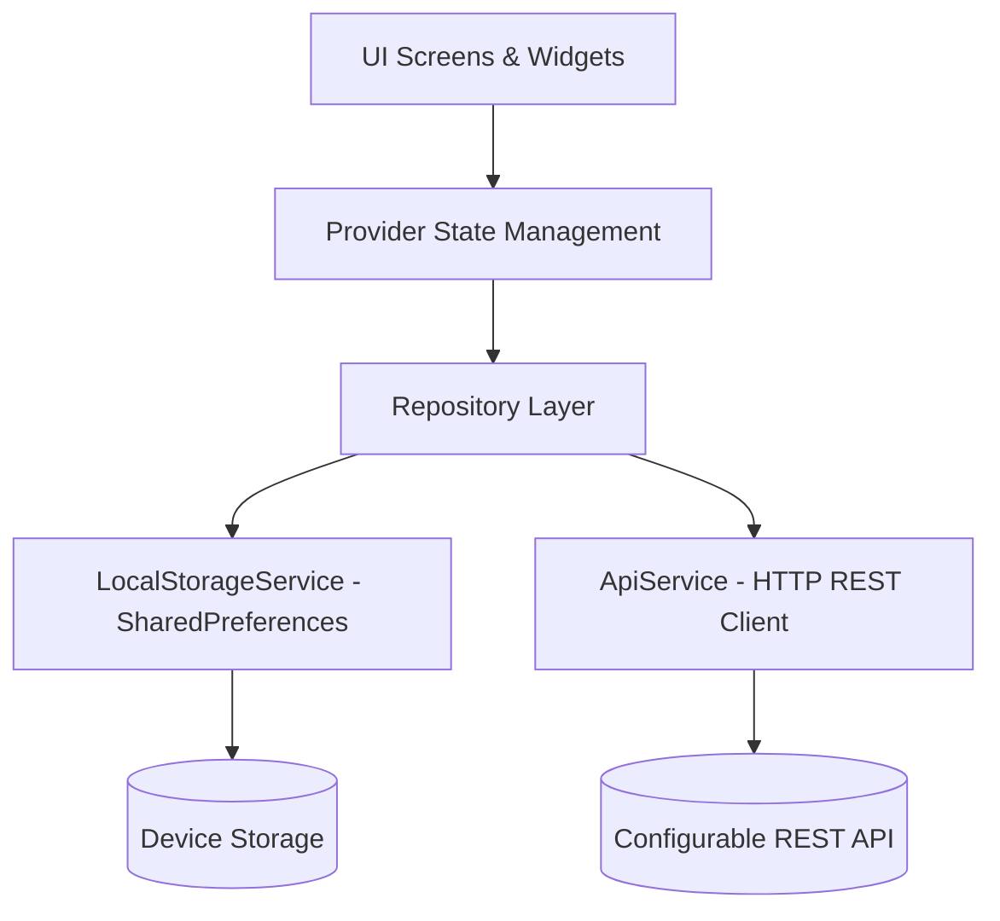

# CampusVerse — Premium College Event Management Application

[](https://flutter.dev)
[](https://dart.dev)
[](https://pub.dev/packages/provider)
[](https://flutter.dev)
[](https://m3.material.io)

**CampusVerse** is a modern, cross-platform **College Event Management Application** built using **Flutter**, **Dart**, and **Material 3**. Engineered for academic mini-project demonstration and college project expos, it features a custom **Dark Glassmorphism UI** system, full **Provider** state management, REST API integration with an offline-first mock fallback, verified digital ticket admission passes with custom **2D QR code matrices**, and persistent local storage.

---

## Table of Contents

1. [Project Overview](#project-overview)
2. [Key Features](#key-features)
3. [Technology Stack & Packages](#technology-stack--packages)
4. [Design Direction & Glassmorphism System](#design-direction--glassmorphism-system)
5. [Application Architecture](#application-architecture)
6. [Folder Structure](#folder-structure)
7. [Installation & Prerequisites](#installation--prerequisites)
8. [How to Run the Application](#how-to-run-the-application)
9. [Running the Test Suite](#running-the-test-suite)
10. [State Management with Provider](#state-management-with-provider)
11. [Navigation & Routing Flow](#navigation--routing-flow)
12. [REST API Integration & Offline Mock Switching](#rest-api-integration--offline-mock-switching)
13. [Customizing Themes & Colors](#customizing-themes--colors)
14. [Mandatory Syllabus Mapping (Weeks 1 to 9)](#mandatory-syllabus-mapping-weeks-1-to-9)
15. [Limitations & Future Enhancements](#limitations--future-enhancements)

---

## 1. Project Overview

Colleges host dozens of technical hackathons, coding workshops, cultural evenings, sports meets, and venture pitches every semester. Students frequently struggle with scattered Google Forms, lost confirmation emails, and cumbersome gate check-ins.

**CampusVerse** solves this by delivering a unified, polished mobile experience where students can:
- **Discover** featured campus events, hackathons, and workshops categorized cleanly.
- **Search & Filter** events in real time by keywords, timeline (Upcoming/Past), and sorting criteria.
- **Inspect Detailed Agendas**, venue details, speaker panels, and real-time seat availability.
- **Register Seamlessly** with validated forms that automatically prevent duplicate signups.
- **Generate Digital Admission Passes** equipped with dynamic **2D QR matrix verification codes** and perforated ticket aesthetics.
- **Bookmark & Track Events** across dedicated tabs (Registered, Saved, Completed) with persistent local storage.
- **Switch Contexts** using a demo Organizer Dashboard to create, edit, and delete events.

---

## 2. Key Features

- **Splash Screen**: Animated brand entrance with glowing radial orb backdrop and automated session routing.
- **Onboarding Carousel**: Multi-slide visual introduction explaining event discovery, verified ticket QR check-ins, and schedule reminders.
- **Student Demo Authentication**: Clean academic demo login with single-click preset student profiles (Alex Chen - CSE, Sophia Patel - ECE, David Miller - IT), avatar picker, and local session persistence.
- **Home / Discover Hub**:
  - Personalized greeting with student avatar and college department.
  - Notification bell with unread badge counter.
  - Instant live keyword search bar.
  - Horizontal scrolling category filter chips with active gradient feedback.
  - Featured Event spotlight glass card with gradient lighting.
  - Horizontal carousel for flagship summits.
  - Vertical upcoming events stream with live seat capacity progress bars and bookmark toggles.
- **Explore Screen**:
  - Comprehensive multi-parameter filtering (All Timelines, Upcoming Only, Past Events).
  - Multi-criteria sorting (Earliest Date, Latest Date, Most Popular, Largest Capacity).
  - Adaptive responsive grid that scales dynamically across mobile (1 column), tablet (2 columns), and desktop web (3 columns).
  - Empty state with reset actions.
- **Event Details Screen**:
  - Hero image animation smoothly transitioning between event cards and detail view.
  - Organizer identity pod with contact avatar.
  - Venue, duration, and seat progress overview.
  - Chronological schedule & speaker agenda cards.
  - Eligibility criteria badge and admission pricing.
  - Sticky bottom glass bar adapting based on registration status.
- **Validated Event Registration Form**:
  - Fields for Student Name, College Email, Roll Number, Department dropdown, Year dropdown, Phone, Team Name, and Code of Conduct acceptance switch.
  - Strict validation preventing empty fields, malformed emails, invalid phone numbers, or unchecked terms.
  - Duplicate registration protection: prevents students from registering twice for the same event.
- **Digital Admission Pass (TicketCard)**:
  - Perforated circular side notches with a dashed tear-off line divider.
  - High-contrast custom-painted **2D QR code matrix** generated deterministically from registration data.
  - Unique verified Registration ID (e.g., `CV-2026-9481`).
  - Pass cancellation and offline wallet saving options.
- **My Events Center**:
  - Three organized tabs: **Registered** (active upcoming passes), **Saved** (bookmarked favorites), and **Completed** (past events).
  - One-tap modal to inspect digital QR pass.
  - Safe registration cancellation flow with confirmation dialog.
- **Notification Center**:
  - Timestamped notifications (success alerts, deadline reminders, venue updates).
  - Read/unread dot indicators and "Mark all as read" capability.
- **Profile & Settings**:
  - Academic credentials display and live state-derived counters (Registered Events & Saved Events).
  - Edit Profile modal dialog.
  - Instant Theme Switcher (Dark Glassmorphism vs Clean Light Material 3).
  - Live REST API backend toggle with custom endpoint configuration.
  - Organizer Dashboard portal.
  - Demo session reset and switch student option.
- **Organizer Dashboard (Demo)**:
  - Create new collegiate events with title, category, venue, capacity, description, and image.
  - Edit existing event parameters.
  - Delete events.
  - View verified student attendee registries and registration capacity statistics.

---

## 3. Technology Stack & Packages

- **Framework**: Flutter SDK (v3.27.4)
- **Language**: Dart (v3.6.2)
- **Design Language**: Material 3 with Custom Glassmorphism
- **State Management**: `provider: ^6.1.5`
- **Networking**: `http: ^1.6.0`
- **Local Persistence**: `shared_preferences: ^2.5.3`
- **Date Utilities**: `intl: ^0.20.2`
- **Icons**: Material Design Icons (`Icons.*`)
- **Testing**: `flutter_test` (Unit tests, Provider tests, Widget tests)

---

## 4. Design Direction & Glassmorphism System

CampusVerse implements a custom glassmorphism design system built upon Flutter's `BackdropFilter` and `ImageFilter.blur`:

```
┌────────────────────────────────────────────────────────┐
│  Dark Background: #090D1A  (Deep Midnight Navy)        │
│  Surface Card:    #1E293B  (Slate 800 with 15% alpha)  │
│  Glass Borders:   #FFFFFF  (White with 12-17% alpha)   │
│  Primary Accent:  #6366F1  (Indigo 500)                │
│  Secondary Accent:#8B5CF6  (Violet 500)                │
│  Electric Accent: #38BDF8  (Sky 400)                   │
│  Blur Radius:     16.0 px (sigmaX: 16, sigmaY: 16)     │
│  Card Radius:     18.0 - 24.0 px                       │
└────────────────────────────────────────────────────────┘
```

Reusable design components:
- `GlassCard`: Encapsulates `ClipRRect`, `BackdropFilter`, translucent background color, and subtle gradient border.
- `GradientOrb`: Ambient radial gradient backgrounds creating soft lighting depth behind glass panels.
- `CategoryChip`: `AnimatedContainer` with dynamic gradient fills and active indicator badges.
- `CustomBottomNavigation`: Floating glass pill navigation bar with active tab glow effects.
- `TicketCard`: Perforated admission ticket with custom QR code matrix.

---

## 5. Application Architecture

CampusVerse adheres to clean separation of concerns:



- **Models**: Plain Dart classes (`Event`, `Student`, `Registration`, `AppNotification`) with immutable fields and robust `fromJson` / `toJson` serialization.
- **Services**: Low-level drivers (`ApiService` for network requests, `LocalStorageService` for `SharedPreferences`).
- **Repositories**: Business logic abstractions (`EventRepository` coordinating local mock vs REST API; `RegistrationRepository` managing ticket creation, duplicate checks, and cancellations).
- **Providers**: `ChangeNotifier` classes exposing reactive state to the UI via `context.watch()` and `context.read()`.
- **Screens & Widgets**: Pure presentation layer responding reactively to state updates.

---

## 6. Folder Structure

```
c:/Users/L2-55/Desktop/flutter/
├── lib/
│   ├── main.dart                      # App entry point, services setup, MultiProvider registration
│   ├── app.dart                       # MaterialApp configuration, routing, and theme bindings
│   ├── core/
│   │   ├── constants/
│   │   │   ├── app_colors.dart        # Hex palettes, gradients, dark/light definitions
│   │   │   └── app_constants.dart     # Categories, departments, academic years, storage keys
│   │   ├── theme/
│   │   │   └── app_theme.dart         # Material 3 ThemeData (darkTheme & lightTheme)
│   │   └── utils/
│   │       ├── date_formatter.dart    # Formatters using the intl package
│   │       └── responsive.dart        # Breakpoint calculations and Responsive layout builder
│   ├── models/
│   │   ├── app_notification.dart      # Notification data model
│   │   ├── event.dart                 # Event & AgendaItem data models
│   │   ├── registration.dart          # Event Registration data model
│   │   └── student.dart               # Student participant data model
│   ├── services/
│   │   ├── api_service.dart           # HTTP client with timeouts and custom exceptions
│   │   └── local_storage_service.dart # SharedPreferences JSON wrapper
│   ├── repositories/
│   │   ├── event_repository.dart      # Hybrid repository (Mock dataset + REST API)
│   │   └── registration_repository.dart # Ticket generator & duplicate check logic
│   ├── providers/
│   │   ├── bookmark_provider.dart     # Bookmarked events state
│   │   ├── event_provider.dart        # Events, search query, category, and sorting state
│   │   ├── notification_provider.dart # In-app notification alerts state
│   │   ├── profile_provider.dart      # Active student session state
│   │   ├── registration_provider.dart # Registrations state and cancellation
│   │   └── theme_provider.dart        # Dark / light theme mode toggle state
│   ├── screens/
│   │   ├── auth/
│   │   │   └── demo_login_screen.dart # Student demo login with preset profiles
│   │   ├── event_details/
│   │   │   └── event_details_screen.dart # Hero image, full details, agenda, and register action
│   │   ├── explore/
│   │   │   └── explore_screen.dart    # Filter modal, search, and responsive grid
│   │   ├── home/
│   │   │   └── home_screen.dart       # Discover hub, hero card, categories, and event streams
│   │   ├── main_shell.dart            # Root shell hosting floating glass bottom navigation
│   │   ├── my_events/
│   │   │   └── my_events_screen.dart  # Registered tickets, saved items, and completed events
│   │   ├── notifications/
│   │   │   └── notifications_screen.dart # Notification center with mark-read actions
│   │   ├── onboarding/
│   │   │   └── onboarding_screen.dart # 3-step carousel with animated indicators
│   │   ├── organizer/
│   │   │   └── organizer_dashboard_screen.dart # Organizer event CRUD & attendee inspection
│   │   ├── profile/
│   │   │   └── profile_screen.dart    # Student profile, stats, theme toggle, and API settings
│   │   ├── registration/
│   │   │   ├── event_registration_screen.dart # Validated participant registration form
│   │   │   └── registration_success_screen.dart # Confirmation pass with QR matrix
│   │   └── splash/
│   │       └── splash_screen.dart     # Animated entrance and session routing
│   └── widgets/
│       ├── category_chip.dart         # Animated category pill with icons
│       ├── custom_bottom_navigation.dart # Floating glass bottom navigation bar
│       ├── error_view.dart            # Friendly error view with retry action
│       ├── event_card.dart            # Vertical & horizontal glass event cards
│       ├── glass_card.dart            # Core glassmorphic BackdropFilter container
│       ├── gradient_orb.dart          # Ambient decorative radial lighting
│       ├── loading_view.dart          # Shimmering loading indicator
│       ├── qr_matrix_painter.dart     # CustomPainter 2D QR matrix generator
│       └── ticket_card.dart           # Perforated ticket with barcode & status badge
├── test/
│   ├── test_helpers/
│   │   └── mock_http_overrides.dart   # Mock HTTP overrides for isolated widget tests
│   ├── unit/
│   │   ├── bookmark_provider_test.dart# Bookmark state operations test
│   │   ├── event_filtering_test.dart  # Search, category, and sorting logic test
│   │   ├── event_model_test.dart      # JSON parsing and seat capacity test
│   │   ├── registration_test.dart     # Duplicate prevention and pass generation test
│   │   └── theme_provider_test.dart   # Theme mode switching test
│   ├── widget/
│   │   ├── home_screen_test.dart      # Home screen rendering test
│   │   ├── registration_form_test.dart# Form validation test
│   │   └── ticket_card_test.dart      # Admission pass QR rendering test
│   └── widget_test.dart               # End-to-end application boot & navigation test
└── pubspec.yaml                       # Dependencies and assets configuration
```

---

## 7. Installation & Prerequisites

### Prerequisites
- **Flutter SDK**: Version 3.20.0 or newer (tested on Flutter 3.27.4).
- **Dart SDK**: Version 3.4.0 or newer (bundled with Flutter).
- **Operating System**: Windows, macOS, or Linux.
- **Target Environments**: Android device/emulator, Chrome/Edge browser (Web), or Windows Desktop.

### Setup Instructions
1. Open PowerShell / Terminal in the project root:
   ```powershell
   cd c:\Users\L2-55\Desktop\flutter
   ```
2. Fetch required dependencies:
   ```powershell
   flutter pub get
   ```
3. Verify that the Flutter environment reports no issues:
   ```powershell
   flutter analyze
   ```

---

## 8. How to Run the Application

You can launch CampusVerse on Chrome Web, Windows Desktop, or an Android device:

### Option A: Run on Google Chrome (Recommended for fast Expo demonstration)
```powershell
flutter run -d chrome
```

### Option B: Run on Microsoft Edge
```powershell
flutter run -d edge
```

### Option C: Run as Native Windows Desktop App
```powershell
flutter run -d windows
```

### Option D: Run on Connected Android Device or Emulator
```powershell
flutter run -d android
```

---

## 9. Running the Test Suite

The test suite contains **20 unit and widget tests** validating all business logic, duplicate checks, models, and UI rendering.

To run all tests:
```powershell
flutter test
```

### Test Coverage Highlights:
- `test/unit/event_model_test.dart`: Validates JSON serialization, `availableSeats`, `isFull`, and `seatsPercentage`.
- `test/unit/registration_test.dart`: Confirms registration creation, verifies duplicate rejection via `RegistrationException`, and tests cancellation.
- `test/unit/event_filtering_test.dart`: Tests category filtering, substring keyword search, and popularity sorting.
- `test/unit/bookmark_provider_test.dart`: Tests adding, toggling, and persisting bookmarks.
- `test/unit/theme_provider_test.dart`: Tests toggling dark/light mode and saving preferences.
- `test/widget/ticket_card_test.dart`: Confirms ticket card rendering and custom QR matrix paint.
- `test/widget/registration_form_test.dart`: Verifies form inline validation for empty names and email checks.
- `test/widget/home_screen_test.dart`: Tests personalized greeting, search input, and category chips.
- `test/widget_test.dart`: Full end-to-end integration test verifying splash entrance, branding, and navigation.

---

## 10. State Management with Provider

CampusVerse uses Provider to manage state without bloated architecture:

| Provider | Responsibilities | Key Methods |
|---|---|---|
| `EventProvider` | Loads events, manages search queries, category filters, timeline filters, sorting, and API mode toggles. | `loadEvents()`, `setSearchQuery()`, `selectCategory()`, `setSortBy()`, `clearFilters()`, `addCustomEvent()` |
| `RegistrationProvider`| Tracks registered events, prevents duplicate roll numbers, generates admission passes, and handles cancellations. | `registerStudent()`, `cancelRegistration()`, `isRegistered()`, `getRegistration()` |
| `BookmarkProvider` | Manages student bookmarks and saved events list. | `toggleBookmark()`, `isBookmarked()`, `removeBookmark()` |
| `ThemeProvider` | Manages theme mode (Dark Glassmorphism vs Clean Light) across the application. | `toggleTheme()`, `setDarkMode()` |
| `NotificationProvider`| Handles in-app simulated event notifications and unread badge counters. | `markAsRead()`, `markAllAsRead()`, `addNotification()` |
| `ProfileProvider` | Manages the active student identity and credentials. | `login()`, `updateProfile()`, `logout()` |

All providers inherit from `ChangeNotifier` and trigger reactive UI rebuilds using `notifyListeners()`. Widgets consume state using `context.watch<T>()` for reactive rebuilding or `context.read<T>()` for one-time method calls.

---

## 11. Navigation & Routing Flow

CampusVerse implements two levels of navigation:

1. **Declarative Named Routes** in `lib/app.dart`:
   - `/` → `SplashScreen`
   - `/onboarding` → `OnboardingScreen`
   - `/login` → `DemoLoginScreen`
   - `/home` → `MainShell(initialIndex: 0)`
   - `/explore` → `MainShell(initialIndex: 1)`
   - `/my-events` → `MainShell(initialIndex: 2)`
   - `/profile` → `MainShell(initialIndex: 3)`
   - `/notifications` → `NotificationsScreen`
   - `/organizer` → `OrganizerDashboardScreen`
2. **Imperative Push & Modal Navigation**:
   - `Navigator.push` with custom `PageRouteBuilder` fade transitions for `EventDetailsScreen` and `EventRegistrationScreen`.
   - `showModalBottomSheet` for inspecting digital QR tickets and filter bottom sheets.
   - `Navigator.pushAndRemoveUntil` when completing registration or logging out to reset the navigation stack cleanly.

---

## 12. REST API Integration & Offline Mock Switching

### REST API Service Layer (`lib/services/api_service.dart`)
CampusVerse includes a real network service layer using Dart's `http` package:
- `fetchEvents()`: Performs `GET $baseUrl/events` with an 8-second timeout, JSON decoding, and status code verification.
- `fetchEventById(id)`: Performs `GET $baseUrl/events/:id`.
- `registerEvent(eventId, payload)`: Performs `POST $baseUrl/events/:id/register` with JSON body payload.
- `ApiException`: Custom exception class providing human-readable network error messages.

### Switching Between Mock & Live API
In **Profile & Settings**:
1. Toggle the **Live REST API Mode** switch:
   - When **OFF (default)**: The application runs completely offline using a local dataset of 8 realistic campus events.
   - When **ON**: The application queries the remote REST API endpoint. If unreachable or offline, it falls back to the local repository without crashing.
2. Tap **Configure API Endpoint URL** to point CampusVerse to any real Node.js, Python, or Go backend endpoint (e.g. `http://localhost:5000/api/v1`).

---

## 13. Customizing Themes & Colors

All colors and styles are centralized:
- **Colors & Gradients**: [lib/core/constants/app_colors.dart](file:///c:/Users/L2-55/Desktop/flutter/lib/core/constants/app_colors.dart)
  - `darkBg`, `primaryGradient`, `accentGradient`, `electricBlue`.
- **Material 3 Theme Settings**: [lib/core/theme/app_theme.dart](file:///c:/Users/L2-55/Desktop/flutter/lib/core/theme/app_theme.dart)
  - `AppTheme.darkTheme`: Dark glass background, glowing elevated cards, dark inputs.
  - `AppTheme.lightTheme`: Clean slate background with crisp indigo accents.
- **Glassmorphism Blur & Corner Radii**: [lib/widgets/glass_card.dart](file:///c:/Users/L2-55/Desktop/flutter/lib/widgets/glass_card.dart)
  - Adjust `blur` (default: 16.0) or `borderRadius` (default: 22.0).

---

## 14. Mandatory Syllabus Mapping (Weeks 1 to 9)

This application satisfies every concept in the academic Flutter syllabus:

| Syllabus Module | Concepts Covered | Implementation in CampusVerse |
|---|---|---|
| **Week 1 — Setup & Dart Basics** | Dart syntax, variables, classes, null-safety, control structures. | Validated in [lib/models/event.dart](file:///c:/Users/L2-55/Desktop/flutter/lib/models/event.dart), [lib/models/student.dart](file:///c:/Users/L2-55/Desktop/flutter/lib/models/student.dart), and repository getters. |
| **Week 2 — Exploring Flutter Widgets** | `Text`, `Image`, `Container`, `Icon`, `Row`, `Column`, `Stack`. | Found throughout [lib/widgets/event_card.dart](file:///c:/Users/L2-55/Desktop/flutter/lib/widgets/event_card.dart) and [lib/screens/splash/splash_screen.dart](file:///c:/Users/L2-55/Desktop/flutter/lib/screens/splash/splash_screen.dart). |
| **Week 3 — Layouts & UI Design** | `Expanded`, `Flexible`, nested widgets, reusable components. | Demonstrated in [lib/widgets/ticket_card.dart](file:///c:/Users/L2-55/Desktop/flutter/lib/widgets/ticket_card.dart) and [lib/widgets/glass_card.dart](file:///c:/Users/L2-55/Desktop/flutter/lib/widgets/glass_card.dart). |
| **Week 4 — Responsive Design** | `MediaQuery`, `LayoutBuilder`, responsive breakpoints. | Implemented in [lib/core/utils/responsive.dart](file:///c:/Users/L2-55/Desktop/flutter/lib/core/utils/responsive.dart) and [lib/screens/explore/explore_screen.dart](file:///c:/Users/L2-55/Desktop/flutter/lib/screens/explore/explore_screen.dart). |
| **Week 5 — Navigation & Routing** | `Navigator.push`, `Navigator.pop`, passing model objects, named routes. | Implemented in [lib/app.dart](file:///c:/Users/L2-55/Desktop/flutter/lib/app.dart), [lib/screens/main_shell.dart](file:///c:/Users/L2-55/Desktop/flutter/lib/screens/main_shell.dart), and [lib/screens/home/home_screen.dart](file:///c:/Users/L2-55/Desktop/flutter/lib/screens/home/home_screen.dart). |
| **Week 6 — State Management & Theming** | `StatelessWidget`, `StatefulWidget`, `Provider`, `ChangeNotifier`, `ThemeData`. | Implemented across [lib/providers/](file:///c:/Users/L2-55/Desktop/flutter/lib/providers/) and [lib/core/theme/app_theme.dart](file:///c:/Users/L2-55/Desktop/flutter/lib/core/theme/app_theme.dart). |
| **Week 7 — Forms & API Integration** | `TextFormField`, dropdowns, switches, form validation, `http` REST calls, JSON parsing. | Implemented in [lib/screens/registration/event_registration_screen.dart](file:///c:/Users/L2-55/Desktop/flutter/lib/screens/registration/event_registration_screen.dart) and [lib/services/api_service.dart](file:///c:/Users/L2-55/Desktop/flutter/lib/services/api_service.dart). |
| **Week 8 — Animations & Testing** | `AnimatedContainer`, `Hero`, `CustomPainter`, unit and widget tests. | Implemented in [lib/widgets/category_chip.dart](file:///c:/Users/L2-55/Desktop/flutter/lib/widgets/category_chip.dart), [lib/widgets/qr_matrix_painter.dart](file:///c:/Users/L2-55/Desktop/flutter/lib/widgets/qr_matrix_painter.dart), and [test/](file:///c:/Users/L2-55/Desktop/flutter/test/). |
| **Week 9 — Mini Project** | Multi-screen application, offline persistence, full user journey. | Complete end-to-end working application across all 10 core screens. |

---

## 15. Limitations & Future Enhancements

### Current Prototype Limitations
- **Simulated Authentication**: Uses demo student profiles saved locally in `SharedPreferences` rather than an OAuth/JWT server.
- **In-App Notifications**: Local notification queue stored on device; not connected to Firebase Cloud Messaging (FCM).
- **Camera QR Scanner**: Generates authentic verified QR codes on admission tickets; scanning via physical camera requires a device camera hardware plugin (`mobile_scanner`).

### Future Enhancements
- Integration with Firebase Authentication & Cloud Firestore.
- Google Calendar / Apple Calendar event synchronization.
- Live push notifications via Firebase Cloud Messaging.
- Camera-based barcode/QR scanner for event organizers to check in attendees at venue doors.
- Payment gateway integration (Razorpay / Stripe) for paid college concert passes.
