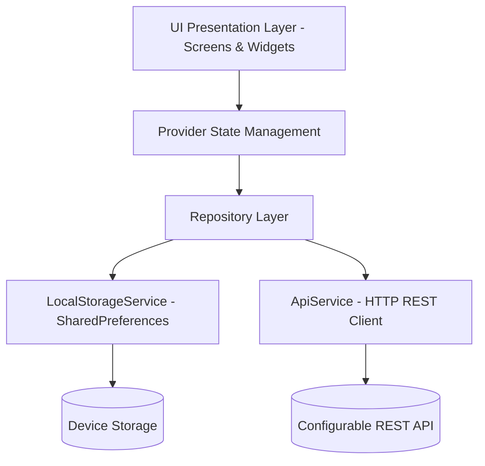

# CampusVerse — Premium College Event Management Application

[](https://flutter.dev)
[](https://dart.dev)
[](https://pub.dev/packages/provider)
[](https://flutter.dev)
[](https://m3.material.io)

**CampusVerse** is a modern, cross-platform **College Event Management Application** built using **Flutter**, **Dart**, and **Material 3**. Engineered for academic mini-project demonstration and college project expos, it features a custom **Dark Glassmorphism UI** system, full **Provider** state management, separated Student and Organizer authentication workflows, authentic ISO **2D QR code tickets**, gate admission scanning with duplicate check-in prevention, and persistent local storage.

---

## Table of Contents

1. [Project Overview](#1-project-overview)
2. [Key Features](#2-key-features)
3. [User Roles & Demo Authentication](#3-user-roles--demo-authentication)
4. [QR Ticket Generation & Gate Verification](#4-qr-ticket-generation--gate-verification)
5. [Layout & Internal Scrolling Architecture](#5-layout--internal-scrolling-architecture)
6. [Developer Settings & REST API Integration](#6-developer-settings--rest-api-integration)
7. [Technology Stack & Packages](#7-technology-stack--packages)
8. [Design Direction & Glassmorphism System](#8-design-direction--glassmorphism-system)
9. [Application Architecture](#9-application-architecture)
10. [Folder Structure](#10-folder-structure)
11. [How to Run the Application](#11-how-to-run-the-application)
12. [Running Flutter Analysis & Test Suite](#12-running-flutter-analysis--test-suite)
13. [Step-by-Step QA & Evaluation Workflows](#13-step-by-step-qa--evaluation-workflows)
14. [Mandatory Syllabus Mapping (Weeks 1 to 9)](#14-mandatory-syllabus-mapping-weeks-1-to-9)
15. [Academic Scope & Limitations](#15-academic-scope--limitations)

---

## 1. Project Overview

Colleges host dozens of technical hackathons, coding workshops, cultural evenings, sports meets, and venture pitches every semester. Students frequently struggle with scattered Google Forms, lost confirmation emails, and cumbersome gate check-ins.

**CampusVerse** solves this by delivering a unified, polished mobile experience where:
- **Students** can discover campus events, inspect schedules and agendas, register seamlessly with duplicate prevention, view their personal digital passes, and access verified QR tickets.
- **Organizers** have a dedicated, protected administrative dashboard to create and edit campus events, inspect live attendee rosters, search attendees, and scan or manually verify tickets at admission gates with duplicate check-in prevention.

---

## 2. Key Features

- **Splash & Onboarding**: Animated brand entrance with glowing radial orb backdrop and automated session routing.
- **Dual-Role Authentication Portal**:
  - Separate tabs for **Student Access** and **Organizer Access**.
  - **Unlimited Student Account Creation** with full form validation, email normalization, and duplicate detection.
  - Returning student login by College Email or University Roll Number.
  - Quick 1-click sample student profiles for rapid evaluation.
  - Protected Organizer authentication with published demo credentials and 1-click evaluator login.
- **Discover & Explore Hub**:
  - Personalized student greeting with avatar and department badge.
  - Instant live keyword search bar.
  - Horizontal scrolling category filter chips with active gradient lighting.
  - Multi-parameter filtering (Upcoming, Past, All Timelines) and sorting (Date, Popularity, Capacity).
  - Responsive layout dynamically adapting across mobile, tablet, and web browsers.
- **Event Details & Validated Registration**:
  - Hero image animation smoothly transitioning between event cards and detail view.
  - Organizer identity pod, venue overview, agenda breakdown, and real-time seat availability.
  - Validated registration modal: ensures required fields, valid email, matching passwords, and terms acceptance.
  - Duplicate registration protection: prevents students from registering twice for the same event.
- **Digital Admission Pass (TicketCard)**:
  - Perforated circular side notches with a dashed tear-off line divider.
  - Real ISO-compliant **2D QR code matrix** generated via `qr_flutter`.
  - Unique verified Registration ID (e.g. `CV-2026-9481`).
  - Admission status badges (`CONFIRMED`, `CHECKED IN`, `CANCELLED`).
  - Registration cancellation with confirmation dialog.
- **My Events Center**:
  - Displays exclusively the active signed-in student's registrations and tickets.
  - Organized tabs: **Registered** (active upcoming passes), **Saved** (bookmarked favorites), and **Completed** (past events).
- **Organizer Dashboard & Management**:
  - Protected by role-aware guards (student accounts are denied administrative privileges).
  - Stat cards: Total Events, Upcoming, Signups, Checked In.
  - Event creation, editing, and deletion.
  - Live attendee registration roster with instant search and filter controls.
  - Direct attendance status toggles and link to Gate Scanner.
- **Organizer Ticket Scanner & Gate Entry**:
  - Live camera QR scanning with visual aim frame (`mobile_scanner`).
  - Dedicated **Manual / Demo Lookup** tab for testing without camera hardware.
  - Gate admission verification states: `VALID`, `ALREADY CHECKED IN`, `CANCELLED`, `EVENT MISMATCH`, and `UNRECOGNIZED`.
  - Duplicate check-in prevention: prevents a scanned ticket from being reused.
- **Dedicated Developer Settings**:
  - Separated from the student profile to maintain a professional user experience.
  - Offline Mock Mode vs Live REST API Mode switch.
  - Configurable remote endpoint base URL with validation.
  - Real HTTP diagnostic connection ping measuring round-trip network latency in milliseconds.

---

## 3. User Roles & Demo Authentication

CampusVerse enforces strict role separation between student attendees and faculty/student organizers.

### Role Separation & Protection Matrix

| Capability | Student Role | Organizer Role |
|---|:---:|:---:|
| Browse & Search Events | Yes | Yes |
| View Event Agendas & Details | Yes | Yes |
| Register for Events | Yes | No (Student Workflow) |
| View Personal Tickets & QR Codes | Yes (Own Only) | No |
| Save / Bookmark Events | Yes | Yes |
| Create, Edit & Delete Events | **Denied** | Yes |
| View Attendee Rosters & Roll Numbers | **Denied** | Yes |
| Access Gate Ticket Scanner | **Denied** | Yes |
| Check In Attendees at Venue Doors | **Denied** | Yes |

*Note: Client-side role checks are implemented for demonstration purposes. In a production deployment with a cloud backend, authorization must also be validated server-side on every request.*

### Demo Credentials for Academic Evaluation

#### 1. Organizer Demo Account
- **Access Route**: Login Screen → Switch to **Organizer** tab.
- **Email**: `organizer@campusverse.edu`
- **Password**: `Organizer@2026`
- **Quick Evaluation**: A **1-Click Organizer Demo Login** button is available on the Organizer Login tab.

#### 2. Sample Student Presets (Optional Quick-Fill)
- **Alex Chen**: CSE, 3rd Year (`alex.chen@campusverse.edu`, Roll: `CS-2024-001`)
- **Sophia Patel**: ECE, 2nd Year (`sophia.patel@campusverse.edu`, Roll: `EC-2025-042`)
- **David Miller**: IT, 4th Year (`david.m@campusverse.edu`, Roll: `IT-2023-118`)

#### 3. Unlimited Student Account Registration
- **Access Route**: Login Screen → Student tab → Tap **"Create New Student Account"**.
- Enter: Full Name, College Email, Roll/Registration Number, Department, Year of Study, Phone Number, Password, and Confirmation.
- Validates field formats, ensures passwords match, and rejects duplicate emails or roll numbers.
- Once created, returning students can log in using either their **Email** or **Roll Number** along with their password.

---

## 4. QR Ticket Generation & Gate Verification

### Ticket Architecture & QR Payload

When a student registers for an event:
1. A unique, collision-resistant Registration ID is generated: `CV-<YEAR>-<RANDOM_ID>` (e.g. `CV-2026-4891`).
2. A compact, standard payload is produced:
   ```text
   CAMPUSVERSE:TICKET:CV-2026-4891
   ```
3. **Student Privacy**: No passwords, private tokens, or unnecessary personal data are encoded into the QR payload.
4. `qr_flutter` renders the authentic ISO/IEC 18004 QR code matrix onto the digital pass.
5. The registration record is saved into persistent storage, linking the student and event.

### Gate Scanner & Verification Logic

When an organizer scans a QR code (or enters the ticket ID manually in the **Manual / Demo** tab):
1. The scanner extracts the registration identifier from the payload.
2. The registration repository retrieves the active record from storage.
3. Verification checks:
   - **Invalid/Empty Format**: Returns `UNRECOGNIZED TICKET`.
   - **Non-Existent Record**: Returns `NOT FOUND`.
   - **Cancelled Pass**: Returns `CANCELLED TICKET` (cannot be admitted).
   - **Event Mismatch**: When the organizer selects a specific event gate, scanning a pass for a different campus event flags `EVENT MISMATCH`.
   - **Already Checked In**: If the ticket was previously admitted, the scanner displays `ALREADY CHECKED IN` with the exact admission timestamp and rejects repeated entry.
   - **Valid Pass**: Displays student name, roll number, department, and event title, with a green **"Confirm Gate Admission & Check In"** action.
4. Once checked in, `isCheckedIn` is set to `true`, `checkedInAt` is recorded, and the state is persisted.

---

## 5. Layout & Internal Scrolling Architecture

To prevent internal scrollbar conflicts, clipping, and RenderFlex overflow errors:
- **Natural Primary Scrolling**: All form screens, dashboards, and detail views use a single parent `SingleChildScrollView` or top-level `ListView`.
- **Keyboard Resilience**: Forms wrap their scroll areas with `SafeArea` and natural padding so fields remain fully visible and scrollable when the virtual keyboard appears.
- **Bottom Navigation Clearance**: The main application shell ensures page content does not clip behind the floating glass bottom navigation bar.
- **Cross-Device Adaptability**: Layouts scale smoothly on compact phones, large tablets, and desktop browsers without hardcoded fixed heights.

---

## 6. Developer Settings & REST API Integration

To preserve a clean, professional profile for normal students, developer tools are housed in a dedicated **Developer Settings** screen (accessible via a subtle shortcut in the student profile or the `/developer-settings` route).

### Features
- **Offline Mock vs Live REST API Switch**:
  - **Mock Mode**: Zero-latency responses using realistic collegiate events.
  - **Live Mode**: Actively communicates with remote microservices via HTTP.
- **Remote API Base URL Configuration**:
  - Validates `http://` and `https://` schemas and host format before saving.
  - Fallback and "Reset to Default URL" options.
- **Live HTTP Diagnostic Connection Test**:
  - Pings the remote endpoint (`/events`) with a 5-second timeout.
  - Validates HTTP 200 responses.
  - Displays round-trip latency in milliseconds (`ms`).
  - Gracefully surfaces connection errors without crashing.

---

## 7. Technology Stack & Packages

- **Framework**: Flutter SDK (v3.27+)
- **Language**: Dart (v3.6+)
- **Design System**: Material 3 with Custom Dark Glassmorphism
- **State Management**: `provider: ^6.1.5`
- **QR Code Generation**: `qr_flutter: ^4.1.0`
- **Barcode & QR Scanning**: `mobile_scanner: ^7.4.2`
- **HTTP Networking**: `http: ^1.6.0`
- **Local Persistence**: `shared_preferences: ^2.5.3`
- **Date Formatting**: `intl: ^0.20.2`
- **Testing**: `flutter_test` (Unit, Widget, and Integration tests)

---

## 8. Design Direction & Glassmorphism System

CampusVerse implements a glassmorphism design system using Flutter's `BackdropFilter` and `ImageFilter.blur`:

```text
┌────────────────────────────────────────────────────────┐
│  Dark Background: #090D1A  (Deep Midnight Navy)        │
│  Surface Card:    #1E293B  (Slate 800 with 15% alpha)  │
│  Glass Borders:   #FFFFFF  (White with 12-17% alpha)   │
│  Primary Accent:  #6366F1  (Indigo 500)                │
│  Secondary Accent:#8B5CF6  (Violet 500)                │
│  Electric Accent: #38BDF8  (Sky 400)                   │
│  Blur Radius:     16.0 px (sigmaX: 16, sigmaY: 16)     │
│  Card Radius:     18.0 - 24.0 px                       │
└────────────────────────────────────────────────────────┘
```

Reusable visual components:
- `GlassCard`: Reusable glassmorphic surface with translucent color, background blur, and hairline borders.
- `GradientOrb`: Ambient radial gradient lighting creating depth behind cards.
- `CategoryChip`: Animated pill with vibrant gradient selection states.
- `CustomBottomNavigation`: Floating glass pill navigation bar with active glow.
- `TicketCard`: Realistic event pass with circular cutouts, dashed tear line, and verified QR code.

---

## 9. Application Architecture

CampusVerse adheres to clean architectural separation:



- **Models**: Immutable Dart data classes (`Event`, `Student`, `Registration`, `AppNotification`).
- **Services**: Low-level drivers (`ApiService` for HTTP requests, `LocalStorageService` for `SharedPreferences`).
- **Repositories**: Business logic abstractions (`EventRepository`, `RegistrationRepository`).
- **Providers**: `ChangeNotifier` state containers (`ProfileProvider`, `EventProvider`, `RegistrationProvider`, `BookmarkProvider`, `NotificationProvider`, `ThemeProvider`).
- **Screens & Widgets**: Reactive presentation layer.

---

## 10. Folder Structure

```text
lib/
├── main.dart                                  # Main bootstrap, MultiProvider registration
├── app.dart                                   # MaterialApp routing & theme bindings
├── core/
│   ├── constants/
│   │   ├── app_colors.dart                    # Hex palettes, gradients, dark/light themes
│   │   └── app_constants.dart                 # Categories, departments, demo credentials
│   ├── theme/
│   │   └── app_theme.dart                     # Material 3 ThemeData (dark & light)
│   └── utils/
│       ├── date_formatter.dart                # Date & time string formatting
│       └── responsive.dart                    # Screen size breakpoints
├── models/
│   ├── event.dart                             # Event model with JSON serialization
│   ├── student.dart                           # Student model, password, sample presets
│   ├── registration.dart                      # Registration model, check-in status, QR data
│   └── notification.dart                      # In-app notifications
├── services/
│   ├── api_service.dart                       # HTTP client for REST backend
│   └── local_storage_service.dart             # SharedPreferences persistence layer
├── repositories/
│   ├── event_repository.dart                  # Event coordination (Mock vs Live)
│   └── registration_repository.dart           # Ticket generation, QR parsing, check-in logic
├── providers/
│   ├── profile_provider.dart                  # Student registration, auth & organizer login
│   ├── event_provider.dart                    # Search, category filters, CRUD operations
│   ├── registration_provider.dart             # Registrations, ticket verification, check-in
│   ├── bookmark_provider.dart                 # Saved events state
│   ├── notification_provider.dart             # Notification state
│   └── theme_provider.dart                    # Dark/light theme state
├── screens/
│   ├── auth/
│   │   └── demo_login_screen.dart             # Dual-role Student / Organizer portal
│   ├── home/
│   │   └── home_screen.dart                   # Discover hub, categories, upcoming events
│   ├── explore/
│   │   └── explore_screen.dart                # Filterable event grid
│   ├── event_details/
│   │   └── event_details_screen.dart          # Event agenda, speakers, registration action
│   ├── registration/
│   │   └── event_registration_screen.dart     # Validated registration form modal
│   ├── my_events/
│   │   └── my_events_screen.dart              # Active student's tickets and bookmarks
│   ├── organizer/
│   │   ├── organizer_dashboard_screen.dart    # Role-protected administrative dashboard
│   │   └── ticket_scanner_screen.dart         # QR camera scanner & manual verification
│   ├── settings/
│   │   └── developer_settings_screen.dart     # Dedicated REST API config & ping
│   └── profile/
│       └── profile_screen.dart                # Student profile, theme toggle, logout
└── widgets/
    ├── glass_card.dart                        # Reusable glassmorphic surface
    ├── ticket_card.dart                       # Perforated admission ticket pass
    └── qr_matrix_painter.dart                 # High-contrast 2D QR code renderer
```

---

## 11. How to Run the Application

### Prerequisites
- Flutter SDK installed and accessible in `PATH`.
- Google Chrome browser (for Flutter Web) or an Android/iOS emulator/device.

### Running Commands

1. **Install Dependencies**:
   ```bash
   flutter pub get
   ```

2. **Run in Chrome (Flutter Web)**:
   ```bash
   flutter run -d chrome
   ```

3. **Run on an Android / iOS Device or Emulator**:
   ```bash
   flutter run
   ```

---

## 12. Running Flutter Analysis & Test Suite

### 1. Static Code Analysis
Run the Flutter analyzer to confirm code health:
```bash
flutter analyze
```
*Current result: **No issues found!***

### 2. Automated Test Suite
Execute the comprehensive test suite covering authentication, duplicate prevention, ticket verification, gate admission, role guards, and UI responsiveness:
```bash
flutter test
```
*Current result: **All 42 tests passed!***

### Test Suite Breakdown

| Test Suite | File | Tests | Focus Areas |
|---|---|:---:|---|
| **Authentication & Profile** | `test/unit/auth_provider_test.dart` | 9 | Student registration, duplicate email/roll checks, login, profile edit, organizer demo auth |
| **Ticket & Gate Verification** | `test/unit/ticket_verification_test.dart` | 8 | Unique ticket generation, QR parsing, gate admission, event matching, duplicate check-in prevention |
| **Registrations & Duplicates** | `test/unit/registration_test.dart` | 3 | Event registration, duplicate prevention, registration cancellation |
| **Event Filtering & Search** | `test/unit/event_filtering_test.dart` | 5 | Category filters, keyword search, popularity sorting, filter reset |
| **Event Model Serialization** | `test/unit/event_model_test.dart` | 3 | JSON parsing, serialization, capacity calculations |
| **Bookmark State** | `test/unit/bookmark_provider_test.dart` | 2 | Bookmark toggling, persistent storage |
| **Theme State** | `test/unit/theme_provider_test.dart` | 3 | Dark glassmorphism default, theme toggle, persistence |
| **Organizer Role Guard (UI)** | `test/widget/organizer_role_guard_test.dart` | 3 | Student access denial screen, organizer dashboard rendering, manual scanner lookup |
| **Home Screen (UI)** | `test/widget/home_screen_test.dart` | 3 | Personalized greeting, search bar, category chips |
| **Registration Form (UI)** | `test/widget/registration_form_test.dart` | 2 | Field validation, terms acceptance checkbox |
| **Ticket Card (UI)** | `test/widget/ticket_card_test.dart` | 1 | Digital pass layout, QR code presentation |
| **App Shell (Integration)** | `test/widget_test.dart` | 1 | Full application boot and navigation |

---

## 13. Step-by-Step QA & Evaluation Workflows

Follow these workflows to evaluate all implemented features:

### Workflow 1: Unlimited Student Registration & Login
1. Launch the application.
2. If already logged in, navigate to **Profile** (bottom navigation tab 4) and tap **"Log Out Student Account"**.
3. On the Login screen (Student tab), tap **"Create New Student Account"**.
4. Fill in:
   - Full Name: `Maya Lin`
   - College Email: `maya.lin@campusverse.edu`
   - University Roll Number: `CS-2026-88`
   - Department: `Computer Science & Engineering`
   - Year: `2nd Year (Sophomore)`
   - Phone: `+1 555-0188`
   - Password: `Password@123`
   - Confirm Password: `Password@123`
5. Tap **"Create Account & Sign In"**.
6. Verify that Maya Lin is registered and redirected to the Home screen with her name in the top greeting.
7. Return to Profile, tap **"Log Out Student Account"**, and log back in using `maya.lin@campusverse.edu` (or `CS-2026-88`) and `Password@123`.

### Workflow 2: Event Registration & Unique QR Ticket Generation
1. In the Home or Explore tab, select an event (e.g. **"HackCampus 2026"**).
2. Tap **"Register for Event"**.
3. Review pre-filled student details, check the Code of Conduct terms, and tap **"Confirm Registration"**.
4. Observe the confirmed registration pass with its unique **Registration ID** (`CV-2026-XXXX`) and authentic **2D QR code**.
5. Navigate to **My Events** (bottom navigation tab 3).
6. Verify that the registered event appears under the **Registered** tab, and tap to reopen the digital ticket pass.

### Workflow 3: Dedicated Organizer Login & Role Guards
1. Log out of the student account via **Profile** → **Log Out**.
2. Select the **Organizer** tab at the top of the Login screen.
3. Observe the displayed demo credentials (`organizer@campusverse.edu` / `Organizer@2026`).
4. Tap **"1-Click Organizer Demo Login"** (or enter the credentials and tap "Sign In as Organizer").
5. Observe the **Organizer Dashboard**:
   - Welcome banner: `Authenticated: Prof. Marcus Vance (Faculty Event Convener)`.
   - Statistics: Total Events, Upcoming, Signups, Checked In.
   - List of managed events with live signup counts.
   - Live Attendee Roster with instant search and filter controls.

### Workflow 4: QR Ticket Gate Scanning & Duplicate Check-in Prevention
1. On the Organizer Dashboard, tap **"Open QR Gate Scanner"** (or the QR icon in the top AppBar).
2. Switch to the **"Manual / Demo"** tab.
3. Notice the quick-fill sample ticket chips listing all active registrations in the database.
4. Tap any active ticket chip (or type the Registration ID from Workflow 2).
5. Tap **"Verify"**:
   - Status badge shows: `VALID ADMISSION TICKET` in green.
   - Student name, roll number, and event title are displayed.
6. Tap **"Confirm Gate Admission & Check In"**:
   - Status transitions to `ATTENDED / CHECKED IN`.
7. Tap **"Verify"** again on the same ticket:
   - Notice that the gate verification rejects repeated entry with `ALREADY CHECKED IN` and records the admission timestamp.
8. Test invalid tickets: Enter `CV-INVALID-999` and tap **"Verify"** to observe `UNRECOGNIZED TICKET`.

### Workflow 5: Developer Settings & HTTP Diagnostic Test
1. While logged in as a student, navigate to **Profile**.
2. Tap **"Developer & API Configuration"** at the bottom of the profile.
3. Observe the dedicated configuration screen:
   - Toggle between **Offline Mock Mode** and **Live REST API Mode**.
   - Review or edit the Remote API Base URL.
   - Tap **"Test Connection"**:
     - The app performs an HTTP GET request with a 5-second timeout.
     - Displays diagnostic status and round-trip latency in milliseconds (`ms`).

---

## 14. Mandatory Syllabus Mapping (Weeks 1 to 9)

This application satisfies every concept in the academic Flutter curriculum:

| Syllabus Module | Concepts Covered | Implementation in CampusVerse |
|---|---|---|
| **Week 1 — Setup & Dart Basics** | Dart syntax, null-safety, classes, enums, control structures. | Models (`Event`, `Student`, `Registration`), `TicketVerificationStatus` enum. |
| **Week 2 — Exploring Flutter Widgets** | `Text`, `Image`, `Container`, `Icon`, `Row`, `Column`, `Stack`. | Custom widgets (`EventCard`, `TicketCard`, `CategoryChip`). |
| **Week 3 — Layouts & UI Design** | `Expanded`, `Flexible`, nested widgets, reusable components. | `GlassCard`, `TicketCard`, single-scroll layouts avoiding overflow. |
| **Week 4 — Responsive Design** | `MediaQuery`, `LayoutBuilder`, responsive breakpoints. | Responsive grid in `ExploreScreen`, `Responsive` utility breakpoints. |
| **Week 5 — Navigation & Routing** | `Navigator.push`, named routes, role-based route guards. | Routing in `lib/app.dart`, role guards in `OrganizerDashboardScreen`. |
| **Week 6 — State Management & Theming** | `ChangeNotifier`, `Provider`, `ThemeData`, dark/light modes. | Six Providers (`Profile`, `Event`, `Registration`, `Bookmark`, `Notification`, `Theme`). |
| **Week 7 — Forms & API Integration** | `TextFormField`, validation, dropdowns, switches, `http` REST client. | `EventRegistrationScreen`, `DemoLoginScreen`, `DeveloperSettingsScreen`. |
| **Week 8 — Custom Painting & Testing** | `CustomPainter`, QR generation, Unit & Widget test suites. | `QrImageView` (`qr_flutter`), 42 comprehensive unit and widget tests. |
| **Week 9 — Mini Project Integration** | Multi-screen application, persistence, end-to-end user journeys. | Complete student & organizer workflows with `SharedPreferences` persistence. |

---

## 15. Academic Scope & Limitations

CampusVerse is engineered specifically for academic project evaluations, code reviews, and project expos:

1. **Local Device Persistence**:
   - Data is persisted on the current client device using `SharedPreferences`.
   - Records (student accounts, custom events, registrations, check-in timestamps) survive application restarts on the same device.
   - For multi-device gate synchronization, connect the app to a shared REST API endpoint using the **Developer Settings** screen.
2. **Client-Side Role Authorization**:
   - Role checks are enforced on the client to present distinct student and organizer user experiences.
   - In a production environment with cloud storage, role authorization must also be validated server-side on every API endpoint.
3. **Hardware Camera Support**:
   - Live camera scanning utilizes `mobile_scanner` and works on physical mobile devices with camera permissions enabled.
   - For web and emulator environments where camera access is unavailable or restricted, the **Manual / Demo Lookup** tab provides full verification and check-in capabilities.
